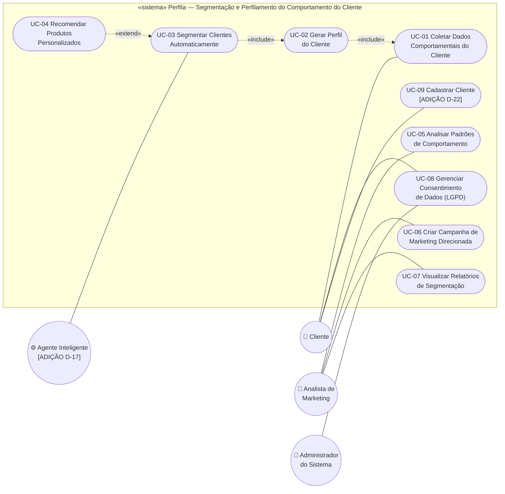

# UML1 — Diagrama de Casos de Uso

> **Fonte:** Módulo 2 · imagem original: [`img/UML1_casos_de_uso.png`](img/UML1_casos_de_uso.png)
> **Imagem corrigida (v1, gerada do Mermaid abaixo):** [`img/v1/UML1_casos_de_uso.png`](img/v1/UML1_casos_de_uso.png)
> **Fonte da verdade para:** atores e casos de uso (Spec 1).
> **Versão:** v1.1 (Core) · **Decisões relacionadas:** D-04, D-07, D-15, D-17, D-22.

## Diagrama (v1.0)

## Elementos

| ID | Caso de uso | Ator primário | Caso de uso de aplicação | MVP | Fase |
|---|---|---|---|---|---|
| UC-01 | Coletar Dados Comportamentais do Cliente | Cliente | `ColetarDadosUseCase` | Sim | Core |
| UC-02 | Gerar Perfil do Cliente | (incluído por UC-03) | `GerarPerfilUseCase` | Sim | Core |
| UC-03 | Segmentar Clientes Automaticamente | Agente Inteligente | `SegmentarClienteUseCase` | Sim | Core |
| UC-04 | Recomendar Produtos Personalizados («extend» de UC-03) | Agente Inteligente | `GerarRecomendacaoUseCase` | Sim | Core |
| UC-05 | Analisar Padrões de Comportamento | Analista de Marketing | — | Não (D-04) | — |
| UC-06 | Criar Campanha de Marketing Direcionada | Analista de Marketing | — | Não (D-04) | — |
| UC-07 | Visualizar Relatórios de Segmentação | Analista de Marketing | — | Não (D-04) | — |
| UC-08 | Gerenciar Consentimento de Dados (LGPD) | Cliente (titular) e Administrador | `GerenciarConsentimentoUseCase` | Sim | Core |
| UC-09 | Cadastrar Cliente [ADIÇÃO] | Cliente / Sistema Externo | `CadastrarClienteUseCase` | Sim | Core |

## Relações

- **UC-02 «include» UC-01**: gerar perfil sempre incorpora a coleta. No código, `GerarPerfilUseCase` reutiliza `ColetarDadosUseCase.Executar` (D-07).
- **UC-03 «include» UC-02**: segmentar depende de um perfil. No código, `SegmentarClienteUseCase` carrega o perfil já gerado; o encadeamento completo é feito pelo handler (RN-09).
- **UC-04 «extend» UC-03**: recomendação é opcional; `ErrSemProdutoElegivel` não interrompe o fluxo (RN-07, RN-09).

## Regras para o agente

1. Implementar somente os UCs com MVP = Sim. UC-05 a UC-07 exigem modelagem antes (D-04).
2. Todo UC que processa dado pessoal (UC-01 a UC-04) começa pelas pré-condições RN-01 (cliente existe → ativo → consentimento válido).
3. UC-08 não exige consentimento válido (é quem o gerencia), mas exige cliente existente.
4. UC-09 é a porta de entrada: cria o cliente ativo e sem consentimento (NAO_CONCEDIDO).

## Divergências registradas

| ID | Divergência | Decisão |
|---|---|---|
| D-07 | O diagrama está **correto** em UML (setas «include» saem do caso base para o incluído). A inversão está apenas no Diagrama de Sequência (passo 5). | Seguir a direção deste diagrama; o comportamento observável é o da sequência. |
| D-22 | Nenhum caso de uso cria o Cliente, mas todos exigem que ele exista. | [ADIÇÃO] UC-09 Cadastrar Cliente, associado ao Cliente. **Ação da equipe:** acrescentar ao diagrama. |
| D-17 | O diagrama tem **Administrador do Sistema** ligado a UC-08 e **não** tem "Agente Inteligente"; UC-02 a UC-04 não têm ator. A versão anterior da Spec usava Cliente para UC-08 e Agente Inteligente para UC-02 a UC-04. | UC-08: Cliente (titular, via API) **e** Administrador. "Agente Inteligente" entra como ator de automação secundário de UC-03/UC-04 (regras determinísticas, não um LLM). **Ação da equipe:** acrescentar o ator ao diagrama até a apresentação final. |

## Rastreabilidade

Spec 3.1 · RN-01 · Features: todas (tags `@UC-xx`) · Código: `internal/application/usecase/`
