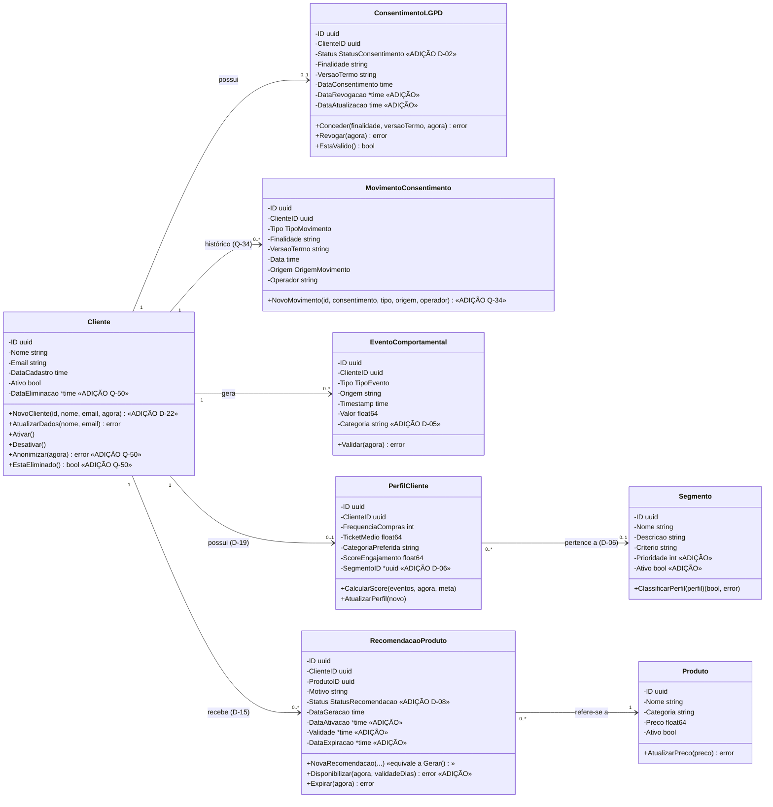

# UML2 — Diagrama de Classes

> **Fonte:** Módulo 3 · imagem original: [`img/UML2_classes.jpg`](img/UML2_classes.jpg)
> **Imagem corrigida (v1, gerada do Mermaid abaixo):** [`img/v1/UML2_classes_dominio.png`](img/v1/UML2_classes_dominio.png) · [`img/v1/UML2_classes_aplicacao.png`](img/v1/UML2_classes_aplicacao.png)
> **Fonte da verdade para:** entidades, campos, métodos e nomes (Spec 1, C-04).
> **Versão:** v1.9 (direitos do titular) · **Decisões relacionadas:** D-02, D-05, D-06, D-08, D-10, D-14, D-15, D-19, Q-34, Q-48 a Q-52.

O modelo abaixo é o **implementado** em `internal/domain/entity`. Campos e métodos marcados `«ADIÇÃO»` não existem na imagem original e foram acrescentados pela Spec.

## Domínio (entidades)

Enumerações (C-05): `TipoEvento` = navegacao | compra | interacao · `StatusConsentimento` = NAO_CONCEDIDO | CONCEDIDO | REVOGADO · `StatusRecomendacao` = GERADA | ATIVA | EXPIRADA · `TipoMovimento` = CONCESSAO | REVOGACAO · `OrigemMovimento` = api | painel | portal | sistema | migracao (v1.4, Q-34).

`MovimentoConsentimento` «ADIÇÃO v1.4, Q-34» é a prova de cada transição de `ConsentimentoLGPD` (RN-10): só de inclusão, sem métodos de alteração. O registro `ConsentimentoLGPD` continua sendo a fonte do estado.

`Cliente.DataEliminacao`, `Anonimizar` e `EstaEliminado` «ADIÇÃO v1.9, Q-50» marcam o cadastro anonimizado pela eliminação a pedido do titular (RN-17): Nome e Email trocados por valores fixos, Ativo false. Depois disso, `AtualizarDados` e um novo `Anonimizar` recusam com `ErrClienteEliminado`. O consentimento e os movimentos do cliente continuam, como prova.

## Aplicação e contratos

```mermaid
classDiagram
  direction TB
  class ColetarDadosUseCase {
    +Executar(ctx, clienteID) []Evento, error
    +Registrar(ctx, evento) error «ADIÇÃO D-12»
  }
  class GerarPerfilUseCase {
    +Executar(ctx, clienteID) PerfilCliente, error
  }
  class SegmentarClienteUseCase {
    +Executar(ctx, clienteID) Segmento, error
  }
  class GerarRecomendacaoUseCase {
    +Executar(ctx, clienteID) RecomendacaoProduto, error
  }
  class GerenciarConsentimentoUseCase {
    +Conceder(ctx, clienteID, finalidade, versao) error
    +Revogar(ctx, clienteID) error
    +Consultar(ctx, clienteID) «ADIÇÃO»
    +Historico(ctx, clienteID) []MovimentoConsentimento, error «ADIÇÃO Q-34»
  }
  class CadastrarClienteUseCase {
    +Executar(ctx, nome, email) Cliente, error «ADIÇÃO D-22»
  }
  class ExpirarRecomendacoesUseCase {
    +Executar(ctx) int, error «ADIÇÃO D-08»
  }
  class AtualizarCadastroUseCase {
    +Executar(ctx, clienteID, nome, email) Cliente, error «ADIÇÃO Q-48»
  }
  class ExportarDadosTitularUseCase {
    +Executar(ctx, clienteID) DadosTitular, error «ADIÇÃO Q-49»
  }
  class EliminarDadosTitularUseCase {
    +Executar(ctx, clienteID, confirmacao) error «ADIÇÃO Q-50, RN-17»
  }
  class AplicarRetencaoUseCase {
    +Executar(ctx) int, error «ADIÇÃO Q-51, RN-18»
  }
  class PerfilamentoService {
    +GerarPerfil(clienteID, eventos) PerfilCliente
  }
  class SegmentacaoService {
    +Segmentar(ctx, perfil) Segmento, error
  }
  class RecomendacaoService {
    +Recomendar(ctx, cliente, perfil, segmento) RecomendacaoProduto, error
  }
  class ValidadorLGPD {
    +ConsentimentoValido(ctx, clienteID) bool, error
  }

  GerarPerfilUseCase ..> ColetarDadosUseCase : «include»
  GerarPerfilUseCase ..> PerfilamentoService
  SegmentarClienteUseCase ..> SegmentacaoService
  GerarRecomendacaoUseCase ..> RecomendacaoService
  ColetarDadosUseCase ..> ValidadorLGPD : RN-01
```

Ports (interfaces) — declarados no **domínio** (`internal/domain/port`, C-02): `ClienteRepository`, `EventoRepository`, `PerfilRepository`, `SegmentoRepository`, `RecomendacaoRepository`, `ConsentimentoRepository`, `ProdutoRepository` «ADIÇÃO D-05», `ConsentimentoGateway`, `IntegracaoGateway`, `Clock`. Assinaturas completas na Spec 3.6. Desde a v1.9 (Q-51, Q-52): `RemoverPorCliente` em `EventoRepository`, `PerfilRepository` e `RecomendacaoRepository`, e `ConsentimentoRepository.ListarRevogadosAte`.

## Diferenças em relação à imagem original

| Original (Módulo 3) | v1.0 | Motivo |
|---|---|---|
| `concedido: bool` | `Status StatusConsentimento` | D-02: bool não distingue NAO_CONCEDIDO de REVOGADO |
| `Segmento.ClassificarPerfil(perfil): bool` | `ClassificarPerfil(p) (bool, error)` | Critério inválido precisa informar `ErrDadosInvalidos` (RN-06) |
| `EventoComportamental.Validar(): bool` | `Validar(agora) error` | Informar a causa; tempo por parâmetro (C-07) |
| `RecomendacaoProduto.Gerar()` | construtor `NovaRecomendacao(...)` + `Disponibilizar` | D-08 |
| `Recomendar(cliente, segmento)` | `Recomendar(ctx, cliente, perfil, segmento)` | RN-07 precisa da categoria preferida |
| Serviços na camada "Aplicação" | Serviços em `domain/service` | D-10: o Diagrama de Componentes prevalece |
| Interfaces de repositório na "Infraestrutura" | Ports em `domain/port` | C-02, D-10 |
| `ConsentimentoLGPD 1 → 0..1 PerfilCliente (possui)` | `Cliente 1 → 0..1 PerfilCliente` | D-19 |
| `EventoComportamental 1 → 0..* RecomendacaoProduto (recebe)` | `Cliente 1 → 0..* RecomendacaoProduto` | D-15 |
| `Segmento 1 — 1 PerfilCliente` | `PerfilCliente 0..* → 0..1 Segmento` | D-06 |
| `ListarAtivos(): [[Segmento` | `ListarAtivos(ctx) ([]Segmento, error)` | erro de digitação no diagrama |
| — (sem catálogo) | `ProdutoRepository` | D-05 |
| — (só o último registro do consentimento) | `MovimentoConsentimento`, `ConsentimentoRepository.Registrar` e `ListarMovimentos`, UC-08 `Historico` | Q-34: prova de cada concessão e revogação (L-06) |
| — (sem direitos do titular) | `Cliente.DataEliminacao`, `Anonimizar`, `EstaEliminado`; casos de uso de correção, exportação, eliminação e retenção | Q-48 a Q-51: art. 18 da LGPD e retenção após a revogação (L-19, L-20) |

## Rastreabilidade

Spec 3.2, 3.3, 3.6 · Features: `evento`, `perfilamento`, `segmentacao`, `recomendacao`, `direitos` · Código: `internal/domain/entity`, `internal/domain/service`, `internal/domain/port`
