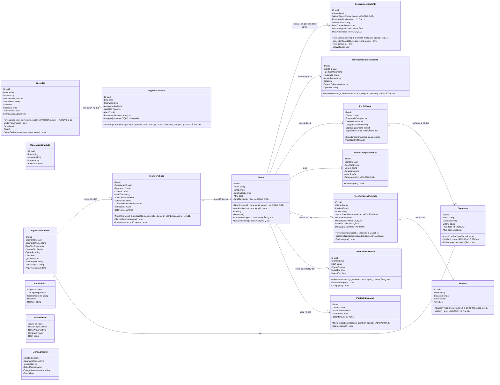

# UML2 — Diagrama de Classes

> **Fonte:** Módulo 3 · imagem original: [`img/UML2_classes.jpg`](img/UML2_classes.jpg)
> **Imagem corrigida (v1, gerada do Mermaid abaixo):** [`img/v1/UML2_classes_dominio.png`](img/v1/UML2_classes_dominio.png) · [`img/v1/UML2_classes_aplicacao.png`](img/v1/UML2_classes_aplicacao.png)
> **Fonte da verdade para:** entidades, campos, métodos e nomes (Spec 1, C-04).
> **Versão:** v1.12 (operadores e auditoria da v1.5; direitos do titular; portal do titular; finalidade e públicos; auditoria dos pedidos, da importação e dos públicos) · **Decisões relacionadas:** D-02, D-05, D-06, D-08, D-10, D-14, D-15, D-19, Q-34, Q-35 a Q-39, Q-48 a Q-52, Q-55 a Q-59, Q-61 a Q-65, Q-68, Q-69.

O modelo abaixo é o **implementado** em `internal/domain/entity`. Campos e métodos marcados `«ADIÇÃO»` não existem na imagem original e foram acrescentados pela Spec.

## Domínio (entidades)



Enumerações (C-05): `TipoEvento` = navegacao | compra | interacao · `StatusConsentimento` = NAO_CONCEDIDO | CONCEDIDO | REVOGADO · `StatusRecomendacao` = GERADA | ATIVA | EXPIRADA · `TipoMovimento` = CONCESSAO | REVOGACAO · `OrigemMovimento` = api | painel | portal | sistema | migracao (v1.4, Q-34) · `PapelOperador` = ADMINISTRADOR | ATENDIMENTO | ANALISTA, com `Pode(Permissao) bool` (matriz da RN-11) · `Permissao` = clientes | consentimento | eventos | processamento | configuracao | editar_configuracao (v1.6) | operacao | usuarios | auditoria | relatorios | eliminacao · `AcaoAuditoria` (lista na RN-13; v1.12, Q-68: + corrigir_cadastro | exportar_dados_titular | eliminar_dados_titular | aplicar_retencao | importar_eventos | exportar_publico | exportar_remocoes_publico | baixar_arquivo_publico) · `TipoAlvo` = cliente | segmento | produto | operador · `ResultadoAuditoria` = SUCESSO | NEGADO | FALHA (v1.5).

Funções puras da configuração (v1.6, RN-14, Q-33): `ValidarCriterio(criterio) error`, `ValidarSegmentos(lista) error` e `NormalizarCategoria(categoria) string` no pacote `entity`; `EscolherSegmento(lista, perfil)` no pacote `service` (a RN-06 sobre uma lista, usada por `Segmentar` e pela prévia).

`Operador` e `RegistroAuditoria` «ADIÇÃO v1.5, Q-35, Q-39» não existem na imagem original: representam quem opera o painel e a trilha do que cada um fez. O registro de auditoria cita o operador pelo login (imutável) e o alvo só por tipo e ID, sem dado pessoal; é só de inclusão. Desde a v1.12 (Q-68) registra também os pedidos do titular (alvo cliente), a importação e a retenção (sem alvo) e os públicos (alvo segmento), sem tipo de alvo novo.

**v1.11 (Q-61):** há um `ConsentimentoLGPD` por (cliente, finalidade), cada um com a máquina do UML5. **Públicos (RN-21):** `ExportacaoPublico` é o registro de cada arquivo, sem dado pessoal; `MembroPublico` liga o cliente ao arquivo pelo `HashEmail` (pseudônimo, ainda dado pessoal) e tem a máquina EXPORTADO → REMOCAO_PENDENTE → REMOVIDO (Spec 3.4.3). Função de domínio `HashEmail(email)`: SHA-256 do e-mail sem espaços e em minúsculas. `LinhaAgregada` (RN-22) não tem identificador.

`MovimentoConsentimento` «ADIÇÃO v1.4, Q-34» é a prova de cada transição de `ConsentimentoLGPD` (RN-10): só de inclusão, sem métodos de alteração. O registro `ConsentimentoLGPD` continua sendo a fonte do estado.

`Cliente.DataEliminacao`, `Anonimizar` e `EstaEliminado` «ADIÇÃO v1.9, Q-50» marcam o cadastro anonimizado pela eliminação a pedido do titular (RN-17): Nome e Email trocados por valores fixos, Ativo false. Depois disso, `AtualizarDados` e um novo `Anonimizar` recusam com `ErrClienteEliminado`. O consentimento e os movimentos do cliente continuam, como prova.

`TokenAcessoTitular`, `PedidoEliminacao` e `MensagemSimulada` «ADIÇÃO v1.10, Q-56 a Q-58» servem ao portal do titular: o link de uso único (só o hash SHA-256 é guardado; 30 minutos; RN-19), o pedido de eliminação que a operação atende (`StatusPedido` = ABERTO | ATENDIDO; RN-20) e a mensagem da caixa de saída simulada (destinatário mascarado; Q-57). `MensagemSimulada` não se liga a `Cliente`: guarda só o e-mail mascarado.

## Aplicação e contratos

```mermaid
classDiagram
  direction TB
  class ColetarDadosUseCase {
    +Executar(ctx, clienteID) []Evento, error
    +Registrar(ctx, evento) error «ADIÇÃO D-12»
  }
  class GerarPerfilUseCase {
    +Executar(ctx, clienteID) PerfilCliente, error
  }
  class SegmentarClienteUseCase {
    +Executar(ctx, clienteID) Segmento, error
  }
  class GerarRecomendacaoUseCase {
    +Executar(ctx, clienteID) RecomendacaoProduto, error
  }
  class GerenciarConsentimentoUseCase {
    +Conceder(ctx, clienteID, finalidade, versao) error
    +Revogar(ctx, clienteID, finalidade) error «v1.11»
    +Consultar(ctx, clienteID, finalidade) «ADIÇÃO»
    +ConsultarFinalidades(ctx, clienteID) []ConsentimentoLGPD, error «ADIÇÃO v1.11»
    +Historico(ctx, clienteID) []MovimentoConsentimento, error «ADIÇÃO Q-34»
  }
  class CadastrarClienteUseCase {
    +Executar(ctx, nome, email) Cliente, error «ADIÇÃO D-22»
  }
  class ExpirarRecomendacoesUseCase {
    +Executar(ctx) int, error «ADIÇÃO D-08»
  }
  class AutenticarOperadorUseCase {
    +Executar(ctx, login, senha) Operador, error «ADIÇÃO Q-36»
    +Conferir(ctx, id, carimbo) Operador, error «ADIÇÃO Q-38»
  }
  class GerenciarOperadoresUseCase {
    +Listar(ctx, ator) []Operador, error
    +Consultar(ctx, ator, id) Operador, error
    +Criar(ctx, ator, login, nome, papel, senha) Operador, error
    +MudarPapel(ctx, ator, id, papel) error
    +Desativar(ctx, ator, id) error
    +Ativar(ctx, ator, id) error
    +RedefinirSenha(ctx, ator, id, senha) error
    +TrocarSenha(ctx, ator, atual, nova) Operador, error
    +CriarAdministradorInicial(ctx, login, senhaHash) bool, error «ADIÇÃO Q-35»
  }
  class RegistrarAuditoriaUseCase {
    +Executar(ctx, operador, acao, alvoTipo, alvoID, resultado) error «ADIÇÃO Q-39»
  }
  class ListarAuditoriaUseCase {
    +Executar(ctx, ator, filtro) PaginaAuditoria, error «ADIÇÃO Q-39»
  }
  class ExpurgarAuditoriaUseCase {
    +Executar(ctx) int, error «ADIÇÃO Q-39»
  }
  class AtualizarCadastroUseCase {
    +Executar(ctx, clienteID, nome, email) Cliente, error «ADIÇÃO Q-48»
  }
  class ExportarDadosTitularUseCase {
    +Executar(ctx, clienteID) DadosTitular, error «ADIÇÃO Q-49»
  }
  class EliminarDadosTitularUseCase {
    +Executar(ctx, clienteID, confirmacao) error «ADIÇÃO Q-50, RN-17»
  }
  class AplicarRetencaoUseCase {
    +Executar(ctx) int, error «ADIÇÃO Q-51, RN-18»
  }
  class SolicitarAcessoTitularUseCase {
    +Executar(ctx, email) error «ADIÇÃO Q-56, RN-19»
  }
  class AutenticarTitularUseCase {
    +Executar(ctx, token) uuid, error «ADIÇÃO Q-56, RN-19»
  }
  class ConsultarMeusDadosUseCase {
    +Executar(ctx, clienteID) MeusDados, error «ADIÇÃO Q-55»
  }
  class PedirEliminacaoUseCase {
    +Executar(ctx, clienteID) PedidoEliminacao, error «ADIÇÃO Q-58, RN-20»
  }
  class GerarPublicoUseCase {
    +Executar(ctx, segmentoID) PublicoGerado, error «ADIÇÃO v1.11»
  }
  class ExportarPublicoUseCase {
    +Exportar(ctx, segmentoID) ExportacaoPublico, error «ADIÇÃO v1.11»
    +ExportarRemocoes(ctx, segmentoID) ExportacaoPublico, error
    +Baixar(ctx, exportacaoID) ExportacaoPublico, ReciboEnvio, error «v1.12 Q-69»
    +Historico(ctx, segmentoID) []ExportacaoPublico, error
  }
  class PropagarRevogacaoUseCase {
    +Executar(ctx, clienteID) int, error «ADIÇÃO v1.11»
  }
  class RelatorioAgregadoSegmentosUseCase {
    +Executar(ctx) []LinhaAgregada, error «ADIÇÃO v1.11»
  }
  class PerfilamentoService {
    +GerarPerfil(clienteID, eventos) PerfilCliente
  }
  class SegmentacaoService {
    +Segmentar(ctx, perfil) Segmento, error
  }
  class RecomendacaoService {
    +Recomendar(ctx, cliente, perfil, segmento) RecomendacaoProduto, error
  }
  class ValidadorLGPD {
    +ConsentimentoValido(ctx, clienteID) bool, error
    +ConsentimentoValidoPara(ctx, clienteID, finalidade) bool, error «v1.11»
  }

  GerarPerfilUseCase ..> ColetarDadosUseCase : «include»
  GerarPerfilUseCase ..> PerfilamentoService
  SegmentarClienteUseCase ..> SegmentacaoService
  GerarRecomendacaoUseCase ..> RecomendacaoService
  ColetarDadosUseCase ..> ValidadorLGPD : RN-01
  AutenticarOperadorUseCase ..> HashSenha : Q-36
  GerenciarOperadoresUseCase ..> HashSenha : Q-36
```



Ports (interfaces) — declarados no **domínio** (`internal/domain/port`, C-02): `ClienteRepository`, `EventoRepository`, `PerfilRepository`, `SegmentoRepository`, `RecomendacaoRepository`, `ConsentimentoRepository`, `ProdutoRepository` «ADIÇÃO D-05», `ConsentimentoGateway`, `IntegracaoGateway`, `Clock`; desde a v1.5, `OperadorRepository`, `AuditoriaRepository` e `HashSenha` (Q-35, Q-36, Q-39). Assinaturas completas na Spec 3.6. Desde a v1.9 (Q-51, Q-52): `RemoverPorCliente` em `EventoRepository`, `PerfilRepository` e `RecomendacaoRepository`, e `ConsentimentoRepository.ListarRevogadosAte`. Desde a v1.10 (Q-57, Q-59): `ClienteRepository.BuscarPorEmail`, `TokenAcessoRepository`, `PedidoEliminacaoRepository`, `Notificador` e `CaixaSaidaSimulada`; os casos de uso de leitura do painel `ListarPedidosEliminacaoUseCase` e `ListarCaixaSaidaUseCase` seguem a Spec 3.5.
  ExportarPublicoUseCase ..> GerarPublicoUseCase
  GerarPublicoUseCase ..> ValidadorLGPD : RN-21
  GerenciarConsentimentoUseCase ..> PropagarRevogacaoUseCase : Revogar (RN-21)
```

Ports (interfaces) — declarados no **domínio** (`internal/domain/port`, C-02): `ClienteRepository`, `EventoRepository`, `PerfilRepository`, `SegmentoRepository`, `RecomendacaoRepository`, `ConsentimentoRepository`, `ProdutoRepository` «ADIÇÃO D-05», `PublicoRepository` «ADIÇÃO v1.11», `ConsentimentoGateway`, `IntegracaoGateway`, `DestinoPublicitarioGateway` «ADIÇÃO v1.11», `Clock`. Assinaturas completas na Spec 3.6.

## Diferenças em relação à imagem original

| Original (Módulo 3) | v1.0 | Motivo |
|---|---|---|
| `concedido: bool` | `Status StatusConsentimento` | D-02: bool não distingue NAO_CONCEDIDO de REVOGADO |
| `Segmento.ClassificarPerfil(perfil): bool` | `ClassificarPerfil(p) (bool, error)` | Critério inválido precisa informar `ErrDadosInvalidos` (RN-06) |
| `EventoComportamental.Validar(): bool` | `Validar(agora) error` | Informar a causa; tempo por parâmetro (C-07) |
| `RecomendacaoProduto.Gerar()` | construtor `NovaRecomendacao(...)` + `Disponibilizar` | D-08 |
| `Recomendar(cliente, segmento)` | `Recomendar(ctx, cliente, perfil, segmento)` | RN-07 precisa da categoria preferida |
| Serviços na camada "Aplicação" | Serviços em `domain/service` | D-10: o Diagrama de Componentes prevalece |
| Interfaces de repositório na "Infraestrutura" | Ports em `domain/port` | C-02, D-10 |
| `ConsentimentoLGPD 1 → 0..1 PerfilCliente (possui)` | `Cliente 1 → 0..1 PerfilCliente` | D-19 |
| `EventoComportamental 1 → 0..* RecomendacaoProduto (recebe)` | `Cliente 1 → 0..* RecomendacaoProduto` | D-15 |
| `Segmento 1 — 1 PerfilCliente` | `PerfilCliente 0..* → 0..1 Segmento` | D-06 |
| `ListarAtivos(): [[Segmento` | `ListarAtivos(ctx) ([]Segmento, error)` | erro de digitação no diagrama |
| — (sem catálogo) | `ProdutoRepository` | D-05 |
| — (sem quem opera) | `Operador`, `PapelOperador.Pode`, `RegistroAuditoria` e os casos de uso de operadores e auditoria | Q-35 a Q-39: papéis, matriz de permissões e trilha de auditoria (L-12, L-23) |
| `Finalidade string`, um consentimento por cliente | `Finalidade` enumerada e um registro por (cliente, finalidade) | Q-61: a finalidade passa a filtrar o uso (L-04) |
| — (UC-06 sem classes) | `ExportacaoPublico`, `MembroPublico`, `LotePublico`, `ReciboEnvio`, `LinhaAgregada` e os casos de uso de públicos | Q-62 a Q-65 |
| — (só o último registro do consentimento) | `MovimentoConsentimento`, `ConsentimentoRepository.Registrar` e `ListarMovimentos`, UC-08 `Historico` | Q-34: prova de cada concessão e revogação (L-06) |
| — (sem direitos do titular) | `Cliente.DataEliminacao`, `Anonimizar`, `EstaEliminado`; casos de uso de correção, exportação, eliminação e retenção | Q-48 a Q-51: art. 18 da LGPD e retenção após a revogação (L-19, L-20) |
| — (sem portal do titular) | `TokenAcessoTitular`, `PedidoEliminacao`, `MensagemSimulada`; casos de uso `SolicitarAcessoTitular`, `AutenticarTitular`, `ConsultarMeusDados`, `PedirEliminacao`; ports `TokenAcessoRepository`, `PedidoEliminacaoRepository`, `Notificador`, `CaixaSaidaSimulada` e `ClienteRepository.BuscarPorEmail` | Q-55 a Q-59, RN-19, RN-20 (v1.10) |

## Rastreabilidade

Spec 3.2, 3.3, 3.6 · Features: `evento`, `perfilamento`, `segmentacao`, `recomendacao`, `direitos` · Código: `internal/domain/entity`, `internal/domain/service`, `internal/domain/port`
