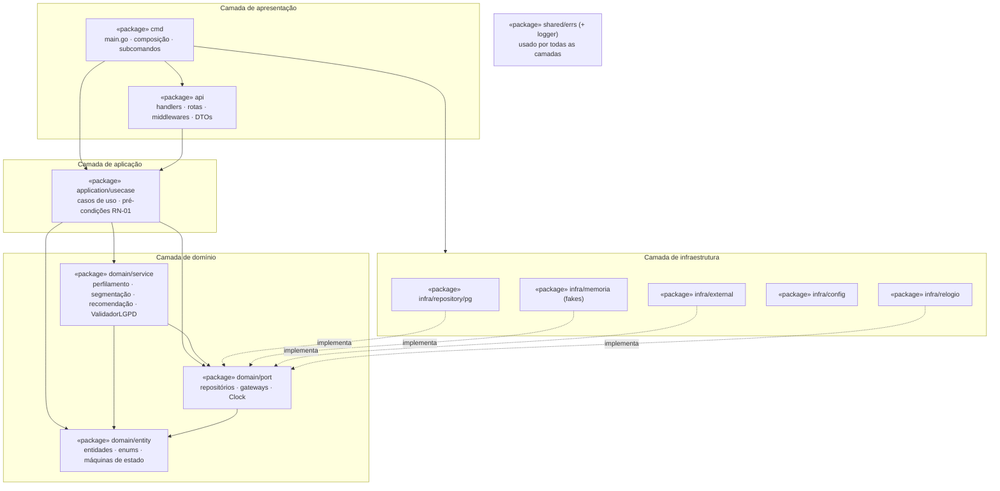

# UML3 — Diagrama de Pacotes

> **Fonte:** Módulo 3 · imagem original: [`img/UML3_pacotes.jpg`](img/UML3_pacotes.jpg)
> **Imagem corrigida (v1, gerada do Mermaid abaixo):** [`img/v1/UML3_pacotes.png`](img/v1/UML3_pacotes.png)
> **Fonte da verdade para:** organização em pacotes Go (complementar ao UML7, que prevalece — D-10).
> **Versão:** v1.0 (Core) · **Decisões relacionadas:** C-01, C-02, D-10.

## Diagrama (v1.0, direção das dependências corrigida)

## Mapeamento para pastas

| Pacote do diagrama | Pasta Go | Fase | Estado |
|---|---|---|---|
| cmd | `cmd/omega-server`, `cmd/perfila-demo` | Support / Core (demo) | **pronto** |
| api | `internal/api` | Support | **pronto** |
| application | `internal/application/usecase` | Core | **pronto** |
| domain | `internal/domain/entity`, `internal/domain/port` | Core | **pronto** |
| service | `internal/domain/service` | Core | **pronto** |
| repository | `internal/infra/repository/pg` (+ `internal/infra/memoria`) | Generic (+ Core) | fakes prontos |
| external | `internal/infra/external` | Support | **pronto** |
| config | `internal/infra/config` | Support | **pronto** |
| shared | `internal/shared/errs` | Core | **pronto** |

## Regras para o agente

1. Imports só apontam para dentro (C-01). O teste `internal/arquitetura_test.go` falha se `domain` importar `api`, `application`, `infra`, `net/http` ou `database/sql`.
2. `shared` não importa nenhuma outra camada (evita ciclo de importação).
3. Interfaces de repositório vivem em `domain/port`, não em `application` (o diagrama original lista "interfaces (portas)" nos dois lugares).

## Divergências registradas

| ID | Divergência | Decisão |
|---|---|---|
| D-10 | Setas `domain → service` e `domain → repository` invertem a regra de dependência e gerariam ciclo de importação em Go; `application` e `domain` listam ambos "interfaces". | O Diagrama de Componentes (UML7) prevalece: infra implementa os ports do domínio; `service` é subpacote do domínio. |

## Rastreabilidade

Spec C-01, C-02, 3.8 · Teste de arquitetura (T-02) · Código: árvore `internal/`
