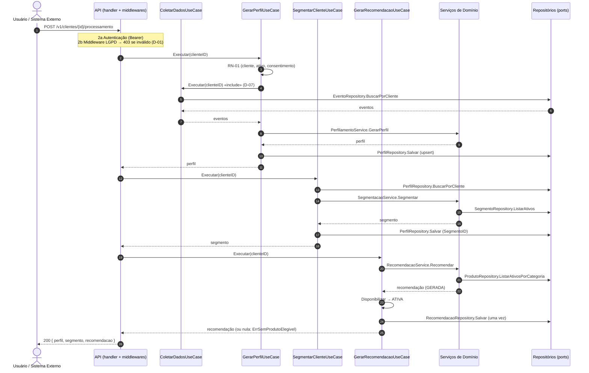

# UML4 — Diagrama de Sequência (processamento de um cliente)

> **Fonte:** Módulo 4 · imagem original: [`img/UML4_sequencia.png`](img/UML4_sequencia.png)
> **Imagem corrigida (v1, gerada do Mermaid abaixo):** [`img/v1/UML4_sequencia.png`](img/v1/UML4_sequencia.png)
> **Fonte da verdade para:** ordem do fluxo de processamento (Spec 1, RN-09).
> **Versão:** v1.0 (Core) · **Decisões relacionadas:** D-01, D-07, D-09.

## Diagrama (v1.0)

Passos numerados como no original; passos novos aparecem com letra (`2a`, `2b`).

## Regras para o agente

1. Ordem fixa: UC-01 (via UC-02) → UC-02 → UC-03 → UC-04 (RN-09). Erro em qualquer etapa interrompe; o que já foi salvo permanece.
2. **Casos de uso persistem, serviços calculam** (D-09). Serviços só leem ports quando precisam (segmentos, produtos).
3. Cada caso de uso repete a checagem RN-01 mesmo com o middleware LGPD (C-03).
4. `ErrSemProdutoElegivel` não interrompe: a resposta sai com `recomendacao: null`.

## Divergências registradas

| ID | Divergência no original | Decisão |
|---|---|---|
| D-01 | Nenhum passo verifica consentimento. | Middleware LGPD (2b) + RN-01 em cada caso de uso. |
| D-07 | Passo 5: Coletar "executa" GerarPerfil (direção inversa ao «include» do UML1). Segmentar não carrega o perfil. | GerarPerfil reutiliza Coletar; Segmentar carrega o perfil; resposta final igual (passo 23). |
| D-09 | Ativações de Segmentação/Recomendação desenhadas sobre a linha de vida do PerfilamentoService; serviços salvando (passos 8 e 20); quatro repositórios dividindo duas linhas de vida. | Nomes e responsabilidades vêm de UML2/UML7. |

## Estado de implementação

- **Core (pronto):** casos de uso e serviços; o fluxo completo roda em memória com `make demo`.
- **Support (pronto):** handler `POST /processamento`, middlewares e DTOs (`internal/api`, `features/api.feature`); `make serve` + `make demo-api`.

## Rastreabilidade

Spec RN-09, 3.5, 3.7 · Features: `perfilamento`, `segmentacao`, `recomendacao`, `api` · Código: `internal/application/usecase`, `cmd/perfila-demo`
