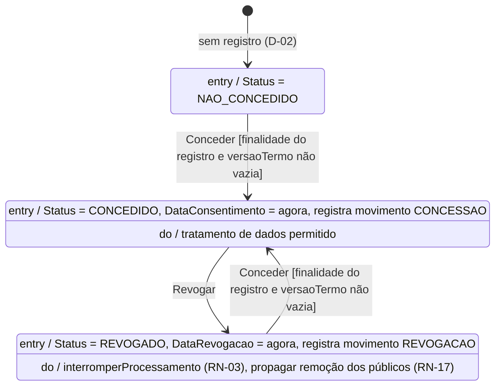

# UML5 — Diagrama de Estados: ConsentimentoLGPD

> **Fonte:** Módulo 4 · imagem original: [`img/UML5_estados_consentimento.png`](img/UML5_estados_consentimento.png)
> **Imagem corrigida (v1, gerada do Mermaid abaixo):** [`img/v1/UML5_estados_consentimento.png`](img/v1/UML5_estados_consentimento.png)
> **Fonte da verdade para:** ciclo de vida do consentimento (Spec 3.4.1).
> **Versão:** v1.9 (por finalidade) · **Decisões relacionadas:** D-02, D-03, Q-34, Q-48, Q-50.

## Diagrama (v1.0)

**v1.9 (Q-48): uma instância desta máquina por (cliente, finalidade).** Finalidades: `segmentacao` (libera UC-01 a UC-04, RN-01) e `publicidade_terceiros` (libera, junto com a `segmentacao`, a entrada nos públicos de campanha, RN-17). As duas mudam de estado de forma independente: revogar uma não mexe na outra. Ausência de registro de uma finalidade = NAO_CONCEDIDO daquela finalidade.

Não há estado final (D-03). `EstaValido()` é **consulta** (`Status == CONCEDIDO`), não transição.

## Tabela de transições

| De | Evento | Guarda | Para | Efeito |
|---|---|---|---|---|
| NAO_CONCEDIDO | Conceder | finalidade igual à do registro e no enumerado; versão não vazia | CONCEDIDO | DataConsentimento = agora |
| CONCEDIDO | Revogar | — | REVOGADO | DataRevogacao = agora; `segmentacao`: UC-01..04 passam a falhar; as duas: membros dos públicos passam a REMOCAO_PENDENTE (RN-17) |
| REVOGADO | Conceder | finalidade igual à do registro e no enumerado; versão não vazia | CONCEDIDO | DataConsentimento = agora |
| qualquer outra | — | — | (sem mudança) | `ErrTransicaoInvalida` |
| guarda violada | — | — | (sem mudança) | `ErrDadosInvalidos` |

`DataAtualizacao = agora` em toda transição. **v1.4 (Q-34, RN-10):** cada transição aplicada por UC-08 grava, na mesma operação atômica, um `MovimentoConsentimento` (CONCESSAO ou REVOGACAO) com finalidade, versão do termo, data e origem. Transição inválida ou guarda violada não gera movimento. Os movimentos nunca são alterados nem apagados; o estado continua vindo do registro. A transição é checada **antes** da guarda (CONCEDIDO + Conceder com finalidade vazia → `transicao_invalida`).

## Regras para o agente

1. Estados são o tipo `StatusConsentimento`, nunca string solta (C-05).
2. Ausência de registro = NAO_CONCEDIDO; `Consultar` devolve um consentimento sintético.
3. Desde a v1.9 a finalidade filtra o uso dos dados (RN-02, Q-48): cada uso confere a sua; `NovoConsentimento` recebe a finalidade, que é parte da chave do registro.
5. Revogar chama `PropagarRevogacaoUseCase` depois de gravar a revogação; falha dela não desfaz a revogação (Q-50).
4. O movimento é montado depois da transição (`NovoMovimento`) e gravado com o registro por `ConsentimentoRepository.Registrar` (v1.4).

## Divergências registradas

| ID | Divergência no original | Decisão |
|---|---|---|
| D-02 | Classe usa `concedido: bool`; o diagrama exige três estados. | Campo `Status` enumerado. |
| D-03 | Transição REVOGADO → estado final rotulada `EstaValido() (retorna true)`. | Sem estado final; `EstaValido` é consulta. |
| — | Nomes `dataConcessao` (estado) × `dataConsentimento` (classe). | Usa-se `DataConsentimento` (classe é a fonte dos nomes). |
| Q-48 | O diagrama tem um único ciclo por cliente, e a finalidade não mudava nada. | Um ciclo por (cliente, finalidade); a guarda passa a conferir a finalidade do registro. |

## Rastreabilidade

Spec 3.4.1, RN-02, RN-03 · Feature: `consentimento.feature` · Código: `internal/domain/entity/consentimento.go`, `usecase/gerenciar_consentimento.go`
