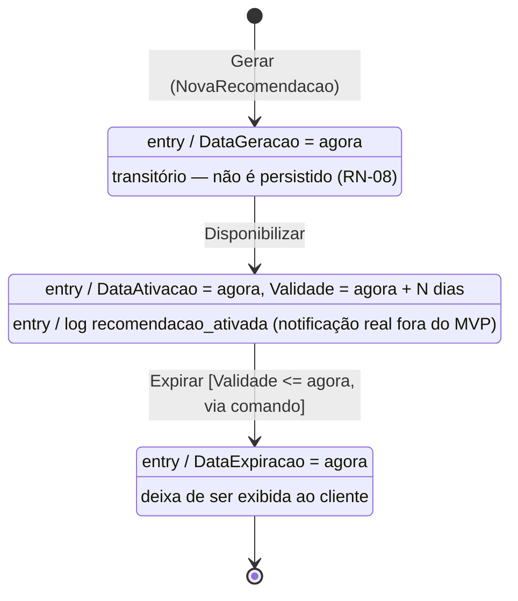

# UML6 — Diagrama de Estados: RecomendacaoProduto

> **Fonte:** Módulo 4 · imagem original: [`img/UML6_estados_recomendacao.png`](img/UML6_estados_recomendacao.png)
> **Fonte da verdade para:** ciclo de vida da recomendação (Spec 3.4.2, RN-08).
> **Versão:** v1.0 (Core) · **Decisões relacionadas:** D-08.

## Diagrama (v1.0)

## Tabela de transições

| De | Evento | Para | Efeito |
|---|---|---|---|
| (início) | Gerar | GERADA | DataGeracao = agora |
| GERADA | Disponibilizar | ATIVA | DataAtivacao = agora; Validade = agora + `RECOMENDACAO_VALIDADE_DIAS` (30) |
| ATIVA | Expirar | EXPIRADA | DataExpiracao = agora |
| EXPIRADA | — | (final) | — |
| qualquer outra | — | (sem mudança) | `ErrTransicaoInvalida` |

UC-04 cria **e já disponibiliza**: a recomendação é gravada uma única vez, em ATIVA. O subcomando `expirar-recomendacoes` (`ExpirarRecomendacoesUseCase`) seleciona as ATIVA com Validade ≤ agora e aplica `Expirar`.

## Regras para o agente

1. Validade usa `AddDate(0, 0, N)` em UTC; exatamente N dias depois já está vencida (≤).
2. Efeitos com I/O (log) ficam no caso de uso, não na entidade.

## Divergências registradas

| ID | Divergência no original | Decisão |
|---|---|---|
| D-08 | Atributos do estado (status, ativação, validade, expiração) e a transição Disponibilizar não existem na classe; ninguém dispara `Expirar()`; `notificarCliente()` não tem port. | Atributos e `Disponibilizar` adicionados; expiração por comando; notificação reduzida a log. |

## Rastreabilidade

Spec 3.4.2, RN-07, RN-08 · Features: `recomendacao_ciclo.feature`, `recomendacao.feature` · Código: `entity/recomendacao.go`, `usecase/gerar_recomendacao.go`, `usecase/expirar_recomendacoes.go`
