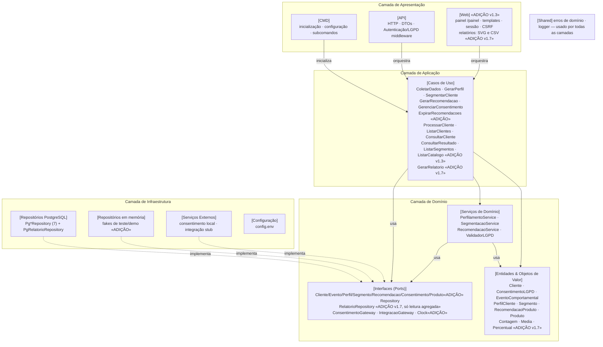

# UML7 — Diagrama de Componentes

> **Fonte:** Módulo 5 · imagem original: [`img/UML7_componentes.png`](img/UML7_componentes.png)
> **Imagem corrigida (v1, gerada do Mermaid abaixo):** [`img/v1/UML7_componentes.png`](img/v1/UML7_componentes.png)
> **Fonte da verdade para:** camadas, ports e direção das dependências (prevalece sobre UML3 — D-10).
> **Versão:** v1.4 (relatórios, 13/11/2026) · **Decisões relacionadas:** C-01, C-02, D-05, D-12, D-16, Q-20 a Q-26, Q-46.

## Diagrama (v1.3)

## Componentes e estado

| Componente | Interfaces oferecidas / requeridas | Fase | Estado |
|---|---|---|---|
| CMD | requer: Casos de Uso, Configuração | Support | **pronto** (`cmd/omega-server`) |
| API | requer: Casos de Uso; oferece HTTP | Support | **pronto** |
| Web (painel) | requer: Casos de Uso; oferece HTML em `/painel` | v1.3 | T-35 a T-38 |
| Casos de Uso | requer: Ports, Serviços | Core | **pronto** |
| Entidades | — | Core | **pronto** |
| Serviços de Domínio | requer: Ports | Core | **pronto** |
| Ports | oferecidos pelo domínio | Core | **pronto** |
| Repositórios em memória | implementa os 7 repositórios + Clock; `RelatorioRepository` sobre os mesmos fakes (v1.7) | Core | **pronto** |
| Repositórios PostgreSQL | implementa os 7 repositórios; `PgRelatorioRepository` com SQL agregado (v1.7) | Generic | **pronto** (T-19); relatórios na T-61 |
| Serviços Externos | implementa ConsentimentoGateway, IntegracaoGateway | Support | **pronto** (local / stub) |
| Configuração | `config.env` (Spec 3.8) | Support | **pronto** |

## Regras para o agente

1. Regra de dependência: todas as setas apontam para dentro, em direção ao domínio (C-01).
2. Toda implementação de port prova conformidade em tempo de compilação: `var _ port.X = (*Impl)(nil)` (C-02).
3. `Clock` é port: `time.Now()` só em `infra/relogio` (C-07).
4. `Web` é um adaptador de apresentação como `API`: importa `application`, `domain/entity` e `shared/errs`, nunca `infra` nem `database/sql`; as duas não se importam (teste de arquitetura, regra "web").
5. Ports novos da v1.3 (Q-23): `ClienteRepository.Listar`, `RecomendacaoRepository.ListarPorCliente`, `ProdutoRepository.ListarTodos`.
6. Port novo da v1.7 (Q-46): `RelatorioRepository`, só de leitura e só de agregados (contagens e somas); nunca devolve linha de cliente. A proteção de grupos pequenos fica no domínio (`ProtegerContagem` e afins), não na infraestrutura.

## Divergências registradas

| ID | Divergência | Decisão |
|---|---|---|
| D-05 | Não há `ProdutoRepository`, mas RN-07 precisa do catálogo. | [ADIÇÃO] `ProdutoRepository`. |
| D-12 | `IntegracaoGateway` sem métodos; nenhum componente mostra a entrada de eventos. | `BuscarEventos(ctx, clienteID, desde)`; stub no MVP; eventos entram por `ColetarDadosUseCase.Registrar`. |
| D-16 | "Autenticação" sem mecanismo. | Token Bearer estático (`AUTH_TOKEN`). |
| Q-20 | O diagrama não tem interface para quem opera; só a API JSON. | [ADIÇÃO] componente Web na apresentação, com sessão própria (Q-22); o `AUTH_TOKEN` nunca vai ao navegador. |
| Q-26 | A orquestração de RN-09 ficava no handler da API. | `ProcessarClienteUseCase` na aplicação, usado por API e Web. |
| Q-46 | UC-05 e UC-07 não têm componente nem port. | [ADIÇÃO] `GerarRelatorioUseCase` na aplicação e `RelatorioRepository` no domínio, implementado em memória e no PostgreSQL. |

## Rastreabilidade

Spec C-01, C-02, 3.6, 3.7.1, 3.8 · Teste de arquitetura · Código: `internal/`
