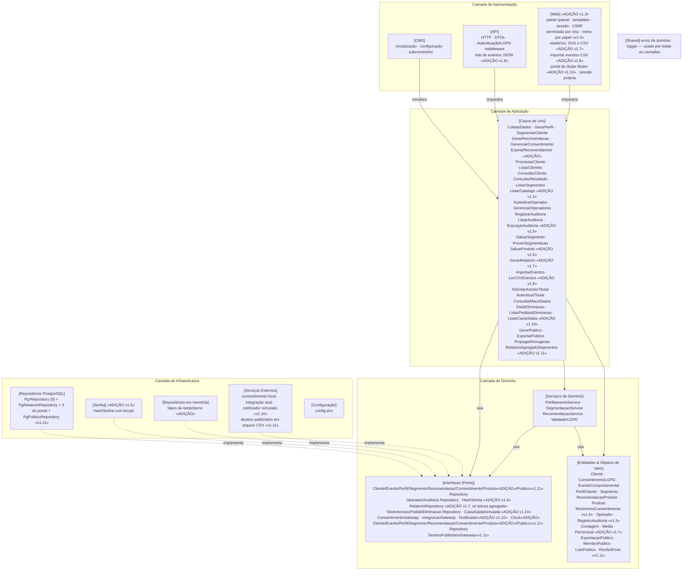

# UML7 — Diagrama de Componentes

> **Fonte:** Módulo 5 · imagem original: [`img/UML7_componentes.png`](img/UML7_componentes.png)
> **Imagem corrigida (v1, gerada do Mermaid abaixo):** [`img/v1/UML7_componentes.png`](img/v1/UML7_componentes.png)
> **Fonte da verdade para:** camadas, ports e direção das dependências (prevalece sobre UML3 — D-10).
> **Versão:** v1.11 (operadores e auditoria da v1.5, relatórios da v1.7, importação de eventos da v1.8 portal do titular e públicos, 14/11/2026) · **Decisões relacionadas:** C-01, C-02, D-05, D-12, D-16, Q-20 a Q-26, Q-35 a Q-39, Q-46, Q-47, Q-55 a Q-59, Q-61, Q-62.

## Diagrama (v1.10)

## Componentes e estado

| Componente | Interfaces oferecidas / requeridas | Fase | Estado |
|---|---|---|---|
| CMD | requer: Casos de Uso, Configuração | Support | **pronto** (`cmd/omega-server`) |
| API | requer: Casos de Uso; oferece HTTP | Support | **pronto** |
| Web (painel) | requer: Casos de Uso; oferece HTML em `/painel` | v1.3 | T-35 a T-38 |
| Web (portal do titular) | requer: Casos de Uso; oferece HTML em `/titular`, com sessão própria | v1.10 | T-78 |
| Notificador simulado | implementa `Notificador` sobre `CaixaSaidaSimulada` (memória e PostgreSQL) | v1.10 | T-76 |
| Casos de Uso | requer: Ports, Serviços | Core | **pronto** |
| Entidades | — | Core | **pronto** |
| Serviços de Domínio | requer: Ports | Core | **pronto** |
| Ports | oferecidos pelo domínio | Core | **pronto** |
| Repositórios em memória | implementa os 7 repositórios + Clock; `PublicoRepository` (v1.11, T-82); `RelatorioRepository` sobre os mesmos fakes (v1.7) | Core | **pronto** |
| Repositórios PostgreSQL | implementa os 9 repositórios; `PgRelatorioRepository` com SQL agregado (v1.7) | Generic | **pronto** (T-19); operadores e auditoria na T-49; relatórios na T-61; `PgPublicoRepository` na T-82 |
| Senha | implementa `HashSenha` (bcrypt, custo 12) | v1.5 | T-49 |
| Serviços Externos | implementa ConsentimentoGateway, IntegracaoGateway | Support | **pronto** (local / stub) |
| Configuração | `config.env` (Spec 3.8) | Support | **pronto** |

## Regras para o agente

1. Regra de dependência: todas as setas apontam para dentro, em direção ao domínio (C-01).
2. Toda implementação de port prova conformidade em tempo de compilação: `var _ port.X = (*Impl)(nil)` (C-02).
3. `Clock` é port: `time.Now()` só em `infra/relogio` (C-07).
4. `Web` é um adaptador de apresentação como `API`: importa `application`, `domain/entity` e `shared/errs`, nunca `infra` nem `database/sql`; as duas não se importam (teste de arquitetura, regra "web").
5. Ports novos da v1.3 (Q-23): `ClienteRepository.Listar`, `RecomendacaoRepository.ListarPorCliente`, `ProdutoRepository.ListarTodos`.
6. Ports novos da v1.5 (Q-35, Q-36, Q-39): `OperadorRepository`, `AuditoriaRepository` e `HashSenha`. O bcrypt sai de `Web` e fica só em `infra/senha` (e no CMD, pela raiz de composição): `Web` confere senha e sessão por `AutenticarOperador`, nunca diretamente.
7. A permissão (RN-11) é conferida em dois lugares, como o consentimento: `Web` confere por rota e esconde o que o papel não pode; os casos de uso de gestão conferem de novo pelo `ator`.
8. Ports novos da v1.6 (Q-33, Q-42, Q-43): `SegmentoRepository.ListarTodos` e `Salvar`, `ProdutoRepository.BuscarPorID` e `Salvar`, `ConsentimentoRepository.ListarConcedidos`. As regras de configuração (RN-14) ficam no domínio; o PostgreSQL só repete as de unicidade, por causa das duas réplicas. A prévia (`PreverSegmentacao`) começa pelo consentimento e devolve só contagens a `Web`.
9. Port novo da v1.7 (Q-46): `RelatorioRepository`, só de leitura e só de agregados (contagens e somas); nunca devolve linha de cliente. A proteção de grupos pequenos fica no domínio (`ProtegerContagem` e afins), não na infraestrutura.
10. A importação em lote da v1.8 (Q-47) não cria port: `ImportarEventosUseCase` grava cada linha por `ColetarDadosUseCase.Registrar` e procura duplicados com `EventoRepository.BuscarPorCliente`. A leitura do CSV fica na aplicação (`LerCSVEventos`, só biblioteca padrão), para o painel e os cenários usarem a mesma regra; a API converte o JSON nas mesmas entradas. O `IntegracaoGateway` continua stub (D-12, Q-03).
11. Ports novos da v1.9 (Q-51, Q-52): `RemoverPorCliente` em `EventoRepository`, `PerfilRepository` e `RecomendacaoRepository`; `ConsentimentoRepository.ListarRevogadosAte`. Os casos de uso dos direitos do titular ficam em `application/usecase` e o painel os chama como os demais.
12. Ports novos da v1.10 (Q-57, Q-59): `ClienteRepository.BuscarPorEmail`, `TokenAcessoRepository`, `PedidoEliminacaoRepository`, `CaixaSaidaSimulada` e o gateway `Notificador`. O portal é parte do componente Web, com roteador, sessão e chave próprios; como o painel, não importa `infra` (teste de arquitetura, regra "web").
13. Ports novos da v1.11 (Q-61, Q-62): `PublicoRepository`, `DestinoPublicitarioGateway`, `PerfilRepository.ListarPorSegmento`, `ConsentimentoRepository` por finalidade (`BuscarPorCliente` com a finalidade, `ListarPorCliente`). O destino é o único ponto que saberá falar com uma plataforma de anúncio; o painel nunca o importa (recebe só o `ReciboEnvio` pelo caso de uso).

## Divergências registradas

| ID | Divergência | Decisão |
|---|---|---|
| D-05 | Não há `ProdutoRepository`, mas RN-07 precisa do catálogo. | [ADIÇÃO] `ProdutoRepository`. |
| D-12 | `IntegracaoGateway` sem métodos; nenhum componente mostra a entrada de eventos. | `BuscarEventos(ctx, clienteID, desde)`; stub no MVP; eventos entram por `ColetarDadosUseCase.Registrar`. |
| D-16 | "Autenticação" sem mecanismo. | Token Bearer estático (`AUTH_TOKEN`). |
| Q-20 | O diagrama não tem interface para quem opera; só a API JSON. | [ADIÇÃO] componente Web na apresentação, com sessão própria (Q-22); o `AUTH_TOKEN` nunca vai ao navegador. |
| Q-26 | A orquestração de RN-09 ficava no handler da API. | `ProcessarClienteUseCase` na aplicação, usado por API e Web. |
| Q-57 | O diagrama não tem como avisar o cliente (notificação fora do MVP). | [ADIÇÃO] port `Notificador`; no MVP, `NotificadorSimulado` com a caixa de saída no banco. |
| Q-62 | Não havia componente para entregar dados a uma plataforma de anúncio (UC-06). | [ADIÇÃO] `DestinoPublicitarioGateway` no domínio, com a implementação em arquivo CSV nos Serviços Externos; trocar por API depois não muda os casos de uso. |

## Rastreabilidade

Spec C-01, C-02, 3.6, 3.7.1, 3.8 · Teste de arquitetura · Código: `internal/`
