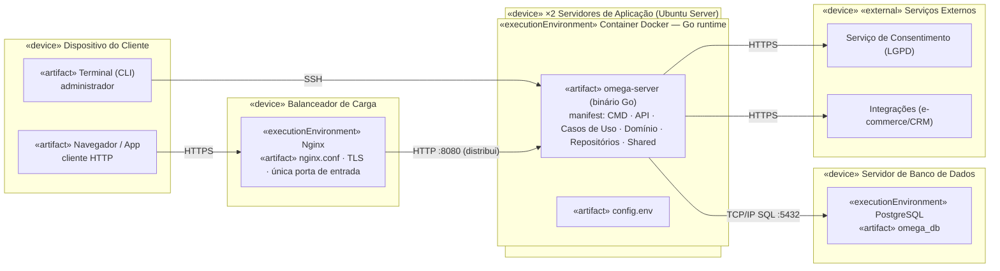

# UML8 — Diagrama de Implantação

> **Fonte:** Módulo 5 · imagem original: [`img/UML8_implantacao.png`](img/UML8_implantacao.png)
> **Imagem corrigida (v1, gerada do Mermaid abaixo):** [`img/v1/UML8_implantacao.png`](img/v1/UML8_implantacao.png)
> **Fonte da verdade para:** servidores, contêineres e configuração (Spec 3.8).
> **Versão:** v1.0 · **Fase de implementação:** Generic (16–19/11) · **Decisões relacionadas:** D-16, D-21.

## Diagrama (v1.0)

## Configuração (`config.env`)

| Variável | Padrão | Uso |
|---|---|---|
| `HTTP_PORT` | 8080 | porta do servidor |
| `DATABASE_URL` | obrigatória | PostgreSQL :5432, banco `omega_db` |
| `AUTH_TOKEN` | obrigatória | token Bearer (D-16) |
| `RECOMENDACAO_VALIDADE_DIAS` | 30 | RN-08 |
| `ENGAJAMENTO_META_EVENTOS` | 30 | RN-05 (deve ser > 0) |
| `LOG_LEVEL` | info | nível de log |

## Regras para o agente

1. Binário estático `omega-server` com subcomandos `serve` e `expirar-recomendacoes`; o administrador os executa por SSH.
2. O cliente nunca acessa o banco: só o balanceador expõe porta pública (cenário em `implantacao.feature`).
3. `GET /saude` sem autenticação, para o balanceador.

## Divergências registradas

| ID | Divergência | Decisão |
|---|---|---|
| D-21 | O produto passou a se chamar **Perfila**, mas os artefatos do diagrama usam o nome da equipe (`omega-server`, `omega_db`). | Mantidos como no diagrama (são nomes de artefato da Equipe Omega); módulo Go e repositório usam `perfila`. |

## Rastreabilidade

Spec 3.8 · Feature: `implantacao.feature` (`@slow`, fora do filtro na fase Core) · Tarefas T-23, T-24
