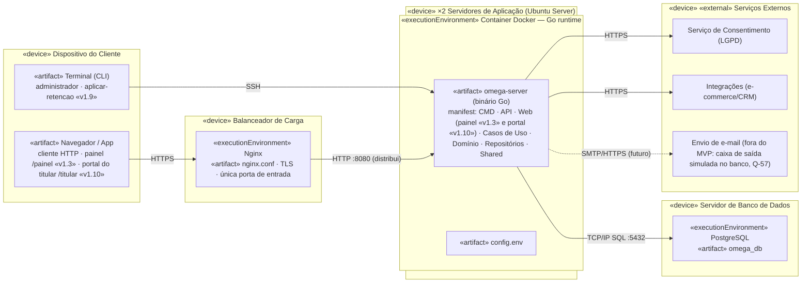

# UML8 — Diagrama de Implantação

> **Fonte:** Módulo 5 · imagem original: [`img/UML8_implantacao.png`](img/UML8_implantacao.png)
> **Imagem corrigida (v1, gerada do Mermaid abaixo):** [`img/v1/UML8_implantacao.png`](img/v1/UML8_implantacao.png)
> **Fonte da verdade para:** servidores, contêineres e configuração (Spec 3.8).
> **Versão:** v1.10 · **Fase de implementação:** Generic (16–19/11), painel web (T-31 a T-38), direitos do titular (T-69 a T-73) e portal do titular (T-75 a T-79) · **Decisões relacionadas:** D-16, D-21, Q-22, Q-28, Q-29, Q-51, Q-55 a Q-60.

## Diagrama (v1.3)

## Configuração (`config.env`)

| Variável | Padrão | Uso |
|---|---|---|
| `HTTP_PORT` | 8080 | porta do servidor |
| `DATABASE_URL` | obrigatória na implantação | PostgreSQL :5432, banco `omega_db`; vazia = modo memória, só fora da implantação (D-23, Q-07) |
| `AUTH_TOKEN` | obrigatória | token Bearer (D-16) |
| `RECOMENDACAO_VALIDADE_DIAS` | 30 | RN-08 |
| `ENGAJAMENTO_META_EVENTOS` | 30 | RN-05 (deve ser > 0) |
| `LOG_LEVEL` | info | nível de log |
| `PAINEL_USUARIO` | operador | login do operador do painel (Q-22) |
| `PAINEL_SENHA_HASH` | vazia = painel desligado | hash bcrypt (`omega-server hash-senha`, Q-28) |
| `PAINEL_CHAVE_SESSAO` | vazia = painel desligado | chave HMAC da sessão, 64 dígitos hexadecimais |
| `PAINEL_FINALIDADE` | segmentacao | finalidade sugerida ao conceder (Q-25) |
| `PAINEL_VERSAO_TERMO` | v1 | versão vigente do termo (Q-25) |
| `RETENCAO_DIAS_REVOGADO` | 180 | prazo da retenção após a revogação, em dias, inteiro > 0 (RN-18, Q-51) |
| `PORTAL_URL_BASE` | vazia = portal desligado | endereço público do portal no link de acesso, o do Nginx (Q-60) |
| `PORTAL_CHAVE_SESSAO` | vazia = portal desligado | chave HMAC da sessão do titular, 64 dígitos hexadecimais, diferente da do painel (Q-60) |

## Regras para o agente

1. Binário estático `omega-server` com subcomandos `serve`, `expirar-recomendacoes`, `hash-senha` (Q-28), `carregar-exemplos` (Q-30) e `aplicar-retencao` (v1.9, RN-18, Q-51); o administrador os executa por SSH.
4. O painel (`/painel`) é servido pelo mesmo binário, atrás do mesmo Nginx; a sessão é assinada e sem estado, então qualquer réplica atende (Q-22). Fontes, CSS e htmx saem do próprio binário: nenhuma requisição a terceiros.
2. O cliente nunca acessa o banco: só o balanceador expõe porta pública (cenário em `implantacao.feature`).
3. `GET /saude` sem autenticação, para o balanceador.
5. O portal do titular (`/titular`, v1.10) também é servido pelo mesmo binário atrás do Nginx, com sessão própria e sem estado. O que precisa valer entre as réplicas fica no banco: o uso único do link, o limite de links por cadastro e a caixa de saída simulada (Q-56, Q-57).

## Divergências registradas

| ID | Divergência | Decisão |
|---|---|---|
| D-21 | O produto passou a se chamar **Perfila**, mas os artefatos do diagrama usam o nome da equipe (`omega-server`, `omega_db`). | Mantidos como no diagrama (são nomes de artefato da Equipe Omega); módulo Go e repositório usam `perfila`. |

## Rastreabilidade

Spec 3.8 · Feature: `implantacao.feature` (`@slow`, fora do filtro na fase Core) · Tarefas T-23, T-24, T-73 (`aplicar-retencao`)
