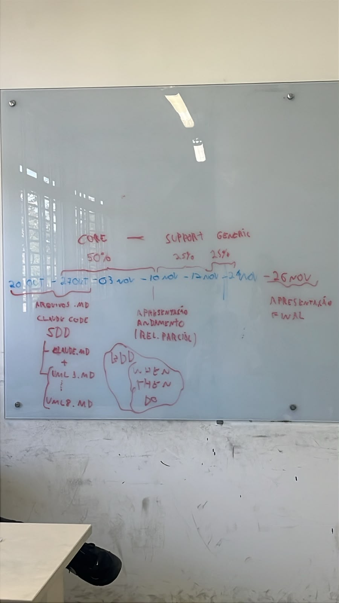

# Plano SDD

**Perfila — Sistema de Segmentação e Perfilamento do Comportamento do Cliente — Go**

Equipe Omega · GoLang & CLP · Documento 2 de 3 · **Versão 1.0 (03/11/2026)**

Este plano organiza como a equipe vai implementar o sistema com apoio de IA generativa seguindo Spec-Driven Development (SDD): a especificação é a fonte da verdade, o agente de código gera a implementação em tarefas pequenas e os cenários BDD provam que o resultado está certo. Referências: **Spec** é o Documento 1 (`specs/spec.md`), **Constituição** é o `CLAUDE.md` e **BDD** é o Documento 3 (`specs/bdd-rules.md` e `features/`). Os IDs C-xx, UC-xx, RN-xx e D-xx vêm da Spec. A lista de tarefas com status fica em `specs/tasks.md`.

## 0. Roadmap (quadro da equipe)



| Período | Marco | Peso | Entrega |
|---|---|---|---|
| 20/10–27/10 | Arquivos `.md` para o Claude Code (SDD) | — | `CLAUDE.md` + `UML1.md` … `UML8.md`; regras BDD (Dado/Quando/Então) |
| 27/10–08/11 | **Core** | 50% | Domínio + aplicação completos, com BDD `@dominio`/`@aplicacao` verdes |
| **09–11/11** | **1ª chamada de acompanhamento** (relatório parcial) | — | Demonstração do core; Trello atualizado |
| 09–13/11 (semana 1) | **Support** | 25% | API HTTP, middlewares, CMD, gateways, configuração — "primeira funcionalidade rodando" pela API |
| 16–19/11 (semana 2) | **Generic** | 25% | PostgreSQL, Docker/Nginx, checklist LGPD |
| **19/11** | **Fechamento do escopo** | — | Depois disso, só correções |
| 20–22/11 | Correções | — | Só defeitos; nenhuma funcionalidade nova |
| 23/11 | Ajustes finais e ensaio | — | Roteiro de demonstração reproduzível |
| **24/11** | **Evento final** | — | Sistema implantado; todas as features do MVP verdes |

**Acompanhamento:** Trello atualizado **toda sexta** (13/11 e 20/11); uma chamada por etapa.

**Corte planejado se a semana 2 apertar:** duas réplicas atrás do Nginx (cenários de réplica em `implantacao.feature`) saem do MVP; o UML8 é demonstrado com uma réplica. Decisão até 17/11.

### Classificação dos subdomínios (DDD)

| Tipo | Subdomínio | Por quê | Onde aparece |
|---|---|---|---|
| **Core** (diferencial) | Perfilamento, Segmentação e Recomendação | É a inteligência do produto: transforma eventos em perfil, segmento e oferta | UC-02, UC-03, UC-04; RN-05 a RN-08 |
| **Support** (específico, não diferencial) | Consentimento LGPD, Coleta de eventos, Catálogo de produtos | Necessários ao negócio, mas não são o diferencial | UC-08, UC-01, `ProdutoRepository` |
| **Generic** (resolvido por padrão de mercado) | Autenticação, Persistência, Implantação, Logs | Qualquer sistema precisa; usa soluções conhecidas | Bearer, PostgreSQL, Docker/Nginx, slog |

O **modelo** de domínio dos subdomínios de suporte (estados do consentimento, validação de evento) foi implementado na fase Core porque o core depende dele (C-03, RN-01). A fase Support entrega a **exposição** desses subdomínios (API, middleware LGPD, gateways).

## 1. Princípios, papéis e rituais

**Princípios**

- A Spec manda. Se o código e a Spec divergem, um dos dois está errado; a correção começa pela Spec.
- Ordem de mudança sempre igual: Spec, depois features, depois código, no mesmo pull request.
- Humanos decidem e aprovam; o agente executa tarefas pequenas, uma por vez (C-12).
- Cada fase termina em um portão objetivo: cenários verdes e verificações automáticas, não opinião.
- Dados pessoais reais nunca entram em prompts, fixtures ou logs (C-09, B-08).

**Papéis sugeridos** (a equipe atribui os nomes; uma pessoa pode acumular papéis)

| Papel | Responsabilidade |
|---|---|
| Guardião(ã) da Spec | Aprova mudanças na Spec e resolve as decisões D-xx |
| Guardião(ã) do BDD | Aprova mudanças em `.feature` e garante cobertura das regras (B-10) |
| Revisor(a) de arquitetura | Confere C-01 e C-02 em cada PR e mantém o teste de arquitetura |
| Operador(a) de IA | Monta o contexto, executa o ciclo da seção 3 e registra dúvidas em `OPEN_QUESTIONS.md` |
| Responsável LGPD | Mantém o checklist da fase F7 e valida requisitos de consentimento |

**Rituais**

- Three Amigos por feature antes das fases F2 e F3: uma pessoa de negócio (Spec), uma de desenvolvimento e uma de teste leem os cenários e ajustam o vocabulário.
- Revisão de PR com checklist fixo (seção 3).
- Retrospectiva curta ao fim de cada fase: o que o agente errou e qual regra da Constituição ou do prompt evitaria o erro.

## 2. Fases e portões

Esforço relativo: P (pequeno), M (médio), G (grande). A ordem vai de dentro para fora, seguindo a Clean Architecture: o domínio primeiro, a infraestrutura e a API depois.

| Fase | Marco | Objetivo | Tarefas | Portão de saída | Esforço | Estado (03/11) |
|---|---|---|---|---|---|---|
| F0 Fundação | Core | Repositório, CI e harness de testes | T-01 a T-03 | `make verify` verde no CI com o teste de arquitetura | P | **Concluída** |
| F1 Fechar a modelagem | Core | Decidir as lacunas e corrigir os diagramas | T-04 | D-01 a D-21 com decisão padrão; Spec v1.0; UML1..UML8 em texto | P | **Concluída** (correção das imagens até 19/11) |
| F2 Domínio | Core | Entidades, estados e serviços | T-05 a T-12 | Features `@dominio` verdes; `domain` sem imports proibidos; cobertura ≥ 80% | G | **Concluída** |
| F3 Aplicação | Core | Ports, fakes e casos de uso | T-13 a T-18 | Features `@aplicacao` verdes com fakes em memória | M | **Concluída** |
| F5 Apresentação | Support | API, middlewares, CMD, gateways, configuração | T-20 a T-23 | Features `@api` verdes, incluindo o processamento ponta a ponta | M | **Concluída** (07/11, adiantada) |
| F4 Infraestrutura | Generic | PostgreSQL e suíte de contrato | T-19 | Suíte de contrato passa com o fake em memória e com o PostgreSQL | M | **Concluída** (11/11, adiantada) |
| F6 Implantação | Generic | Contêiner, balanceador e réplicas | T-24 | Features `@implantacao` verdes (réplicas: corte planejado) | M | **Concluída** (11/11, com duas réplicas) |
| F7 Fechamento | Generic | Conformidade, documentação e demonstração | T-25 | Checklist LGPD; README; roteiro de demonstração | P | **Concluída** (11/11) |

A API (F5) vem antes do PostgreSQL (F4) porque roda sobre os fakes em memória: a fase Support entrega o fluxo HTTP completo sem depender de banco, e a Generic só troca a infraestrutura.

## 3. Ciclo de execução de uma tarefa com IA

1. **Selecionar** uma tarefa T-xx cujas dependências já estejam concluídas.
2. **Montar o contexto mínimo**: `CLAUDE.md` (Constituição), o `docs/uml/UMLx.md` correspondente, as seções da Spec citadas na tarefa e as features com as tags da tarefa. Nada além disso.
3. **Pedir ao agente, em ordem**: passos e testes primeiro (vermelho), código depois (verde), refatoração por último.
4. **Verificar**: o agente roda `make verify` (formatação, `go vet`, `go test -race ./...`, features e teste de arquitetura). Até 3 ciclos de correção automática; depois, triagem humana.
5. **Revisar** com o checklist abaixo e fazer merge.
6. **Registrar**: atualizar a rastreabilidade (seção 5); se surgiu dúvida de regra, resolver com o Guardião da Spec antes de seguir (a Spec muda primeiro).

Modelo de prompt por tarefa:

```text
Contexto: leia CLAUDE.md, specs/spec.md (seções: <lista>), docs/uml/<UMLx>.md e as features com as tags <lista>.
Tarefa: <T-xx — descrição>.
Restrições: não altere specs/ nem arquivos .feature; não crie campos, métodos, rotas
ou tabelas que não estejam na spec; se algo estiver ambíguo, pare e escreva as
perguntas em OPEN_QUESTIONS.md.
Entrega: testes e código; rode make verify; resuma os arquivos alterados e os
cenários cobertos.
Aceite: cenários <tags> verdes; teste de arquitetura verde; mudança de até ~300 linhas.
```

Checklist de revisão do PR:

- Respeita C-01 a C-12 (imports, ports, consentimento, nomes, tipos, erros, contexto e tempo, sem global, sem dado pessoal em log)?
- Não há campo, método, rota ou tabela fora da Spec?
- Os cenários da tarefa estão verdes e nenhum `.feature` foi alterado sem mudança de Spec?
- Comentários `// Spec:` apontam para os IDs corretos?
- O PR é pequeno o bastante para ser lido em uma sentada?

Definição de pronto (vale para toda tarefa): compila; `make verify` verde; cenários das tags da tarefa verdes; teste de arquitetura verde; rastreabilidade atualizada; nenhuma pergunta aberta sem dono.

## 4. Tarefas

A lista de tarefas T-01 a T-27, com dependências, prova, marco e status, está em [`specs/tasks.md`](tasks.md).

## 5. Rastreabilidade

| Origem (diagrama) | Arquivo | Onde está na Spec | Features | Tarefas | Código |
|---|---|---|---|---|---|
| Casos de uso (Mód. 2) | UML1 | 3.1 e RN-01 | Todas (tags `@UC-xx`) | T-14 a T-18 | `application/usecase` |
| Classes (Mód. 3) | UML2 | 3.2 e 3.3 | `evento`, `perfilamento`, `segmentacao`, `recomendacao` | T-05 a T-11 | `domain/entity`, `domain/service` |
| Pacotes (Mód. 3) | UML3 | C-01 e 3.8 | Teste de arquitetura | T-02 | `internal/arquitetura_test.go` |
| Sequência (Mód. 4) | UML4 | RN-09, 3.5 e 3.7 | `api.feature` (+ demo) | T-21, T-26 | `cmd/perfila-demo` |
| Estados do consentimento (Mód. 4) | UML5 | 3.4.1 | `consentimento.feature` | T-07 e T-14 | `entity/consentimento.go` |
| Estados da recomendação (Mód. 4) | UML6 | 3.4.2 | `recomendacao_ciclo.feature` | T-11 e T-27 | `entity/recomendacao.go` |
| Componentes (Mód. 5) | UML7 | C-02, 3.6 | Teste de arquitetura | T-13 | `domain/port`, `infra/memoria` |
| Implantação (Mód. 5) | UML8 | 3.8 | `implantacao.feature` | T-23 e T-24 | `deploy/` (Generic) |

## 6. Riscos e critérios de sucesso

| Risco | Mitigação |
|---|---|
| O agente inventa campos, métodos ou rotas | C-04 e C-12; revisão do diff contra a Spec; perguntas em `OPEN_QUESTIONS.md` |
| Spec e código divergem com o tempo | Features executáveis no CI; comentários `// Spec:`; mudança sempre na ordem Spec, features, código |
| Diagramas inconsistentes geram código ambíguo | Fase F1 antes da F2; decisões D-xx registradas na Spec |
| Vazamento de dados pessoais em prompts ou logs | Dados sintéticos (B-08), C-09 e checklist da F7; nunca colar dados reais no agente |
| PRs grandes e difíceis de revisar | Uma tarefa por vez; limite aproximado de 300 linhas |

Critérios de sucesso do plano:

- Todas as features verdes no CI e nenhuma violação do teste de arquitetura.
- Todas as decisões D-01 a D-21 resolvidas e refletidas nos diagramas (imagens) e na Spec.
- Fluxo completo do diagrama de sequência demonstrável na implantação com duas réplicas.
- Registro, por tarefa, de quantas tentativas o agente precisou; serve para ajustar o prompt e a Constituição.
